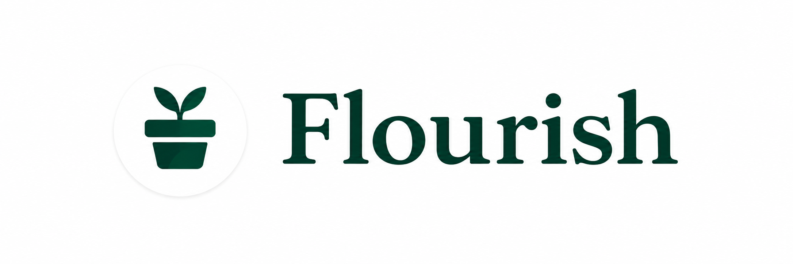
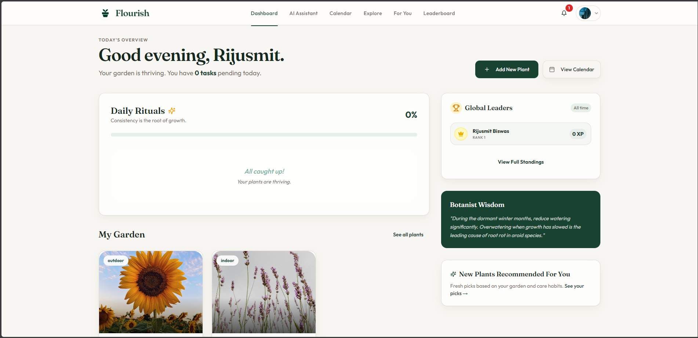

  

<h1 align="center">Flourish</h1>

<b>Transform your black thumb into a green one.</b>

  
  
  
  
  
  
  
  
  
  
  

<a href="https://flourish-web-iota.vercel.app/"><b>Try it live → flourish-web-iota.vercel.app</b></a>

  
   
  <i>Your digital garden: today's rituals, your plants, the leaderboard, and a daily dose of botanist wisdom.</i>

---

## Hello, and welcome to Flourish 🌱

Most people do not kill plants because they lack care. They kill plants because caring is hard to do *consistently*.

Every plant needs something slightly different. Nobody tells you when to water until it is already too late. You water on Sundays because that is the day you remember, not the day your fern actually needs it. By the time the leaves show something is wrong, the damage is done.

**Flourish exists because we got tired of that gap between wanting to keep something alive and actually knowing how.**

## What Flourish is all about

Flourish is not a simple reminder app with a pretty plant picture. It is closer to a **second pair of eyes on your garden**.

- 🌿 **It knows your plants.** It can tell a pothos from a peace lily. Every plant you add is a living thing with a species, a light requirement, and a watering rhythm, pulled from real horticultural data rather than guessed.
- 🔄 **Care that responds.** The schedule is not a fixed countdown. Skip a watering and the plan adjusts instead of nagging you later. It is a plan that notices when it is being ignored, not a checklist that never does.
- 💬 **Ask PlantMind.** Curling leaf? Yellow patch? Skip the forum threads. PlantMind is the assistant built into Flourish, and it answers real plant questions with the same grounded knowledge behind your care schedules.

## What it feels like day to day

You open the app to a **garden**, not a dashboard. You see a short list of what actually needs doing today instead of a wall of everything, all the time. You check things off and your plants respond to the care you give them.

The app quietly notices your progress. A streak forms and your garden health trends upward. You get a small, honest sense that you are actually good at this now, not because you memorized a schedule, but because something was watching the details for you.

If you like friendly competition, there is a leaderboard for that too. Keeping a plant alive for six months is a real accomplishment, and it should feel like one.

---

## A walkthrough of the main products

| | Feature | What it does |
|---|---|---|
| 🏡 | **Dashboard** | Your garden at a glance: today's care tasks, the current health of every plant, and quick actions for what you need to do right now. Nothing is buried and nothing is padded with filler. |
| 🤖 | **PlantMind** | The chat assistant built into Flourish. Ask plant care questions in plain language and get personalized advice grounded in the same data behind your care schedules, not a generic script. |
| 📅 | **Calendar** | Every upcoming watering, fertilizing, and health check for your whole garden in one place. The full schedule, not just today's slice. |
| 🔍 | **Explore** | The plant lookup tool. Search any plant and see its real care needs, native habitat, and common issues before you bring it home or add it to your garden. |
| ✨ | **Recommendations** | Plants picked for *your* garden, based on what you already grow and how well you are caring for it. Personalized, not a generic bestseller list. |
| 🏆 | **Leaderboard** | See how your gardening streak and score stack up against other Flourish growers. Consistent care becomes progress you can actually see. |

---

## The bet we are making

Most plant apps assume the hard part is *remembering*. We think the hard part is **knowing what your specific plant needs right now**, given what has actually happened to it lately.

Flourish leans almost all of its intelligence into that goal:

- We ground recommendations in **real plant data first**.
- We use **artificial intelligence to fill the gaps** and answer what a database cannot.
- We **never pretend a generic tip is personal advice.**

We also think caring for something living should not feel like administrative work. The app is built to feel warm rather than clinical: more like a garden journal that happens to be smart, and less like a spreadsheet with push notifications.

## At a glance

- ✅ **Real data, not improvisation.** Care facts come from a real horticultural database, not an AI making up a watering schedule.
- ✅ **Schedules that move.** Miss a watering and the plan adjusts instead of quietly drifting out of sync with reality.
- ✅ **An assistant that's accountable.** PlantMind answers plant questions backed by the same data as your care plan.
- ✅ **Progress that feels like progress.** Streaks, garden health trends, and a leaderboard for the mildly competitive.

---

## The technical stack

Flourish is a monorepo: a **React frontend** talking to a **FastAPI backend**, with **Firebase** handling the account and data layer for both.

| Layer | Technology |
|---|---|
| **Frontend** | React 18 and TypeScript, built with Vite |
| **UI** | Tailwind CSS and Radix primitives |
| **Client state & routing** | TanStack React Query for server state, React Router for navigation |
| **Forms** | React Hook Form and Zod |
| **Charts & content** | Recharts; PlantMind replies are rendered with react-markdown |
| **Backend** | FastAPI on Python 3.12, served by Uvicorn |
| **Care agent** | LangChain with Groq for language model inference and Tavily for grounded web search |
| **Scheduled jobs** | APScheduler drives recurring jobs like streak checks and task digests, on a host with a persistent process |
| **Plant data** | Perenual supplies the deterministic facts (watering cadence, sunlight needs); Groq fills in what a database cannot answer |
| **Extras** | OpenWeather for weather adjustments, Unsplash for plant photography |
| **Auth, data, storage** | Firebase: Google authentication, Firestore, and Storage for images |
| **Notifications** | The Firebase Trigger Email extension for delivery |
| **Deployment** | Vite build on Vercel, Docker image on Render; GitHub Actions runs continuous integration and keeps the API warm |

---

## Try it out today

Sign in with Google, add the plant that is currently judging you from across the room, and see what Flourish thinks it actually needs.

👉 **[flourish-web-iota.vercel.app](https://flourish-web-iota.vercel.app/)**

Are you building on this, or just curious how it is put together? The engineering documents live in the [docs folder](docs/) and start with the [product requirements document](docs/01-PRD.md).
